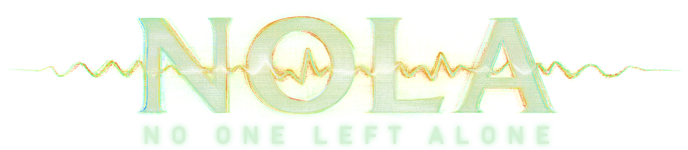

<b>Co-op for S.T.A.L.K.E.R. 2: Heart of Chornobyl. Walk the Zone with friends, in the same world, each with your own character.</b>

<a href="https://www.nexusmods.com/stalker2heartofchornobyl/mods/3050">Nexus Mods</a> ·
<a href="https://github.com/Joaovitor404silva/NOLA-Stalker2-Coop/releases/latest">Download</a> ·
<a href="CHANGELOG.md">Changelog</a> ·
<a href="https://ko-fi.com/jaumn">Support on Ko-fi</a>

> Status: **v1.3.2** (see the [Changelog](CHANGELOG.md)). It works and has been played a lot in testing, but it is not finished and it will have bugs. Please read [Known issues](KNOWN_ISSUES.md) before you start.

---

## What NOLA is

NOLA is a fan-made co-op mod for S.T.A.L.K.E.R. 2: Heart of Chornobyl. One player hosts and runs the Zone. Up to five players (the host plus four friends) share that world: you see each other, fight the same enemies, loot the same bodies, follow the same story, and pick each other up when you go down.

The host's world is the real one: the host decides what the A-Life, the NPCs, the weather and the quests do. Everyone else joins that world and keeps their own character (gear, condition, attachments and health). If you do not press the co-op buttons, the game plays like normal solo STALKER 2.

NOLA is free and open source under the [GPL-3.0 licence](LICENSE).

## At a glance

- Up to **5 players**: the host plus four friends.
- Connect through **Steam friends** or **LAN / IP** (VPN works too).
- One shared Zone: same NPCs, enemies, loot and story, run by the host.
- Every player keeps their **own character**.
- Downed and revive, friendly fire, and everyone loads together with the host.
- Solo play is unchanged when you don't press the co-op buttons.

## Play

Download the latest release from [Nexus Mods](https://www.nexusmods.com/stalker2heartofchornobyl/mods/3050) or [GitHub Releases](https://github.com/Joaovitor404silva/NOLA-Stalker2-Coop/releases/latest), then follow [Install and play](INSTALL.md).

| Page | What is in it |
|---|---|
| [Features](FEATURES.md) | Every feature, grouped by area, with how well it is tested |
| [Known issues](KNOWN_ISSUES.md) | What is broken or not checked yet |
| [Changelog](CHANGELOG.md) | What changed in each version |
| [Roadmap](ROADMAP.md) | What is released, what is next, what is planned for V2, and ideas |
| [Install and play](INSTALL.md) | Requirements and a quick start |
| [Settings](FLAGS.md) | What each setting does and how to turn features off |
| [FAQ](FAQ.md) | Common questions |
| [Credits](CREDITS.md) | Credits, disclaimer and AI disclosure |

## Source code

This repository holds the full source of the mod: the native UE4SS C++ mod, the data tables, the offline tests, the packaging and installer scripts, and the reverse-engineering scripts.

| Folder | What is in it |
|---|---|
| `src/` | The native mod (`main.dll`), C++ on top of [RE-UE4SS](https://github.com/UE4SS-RE/RE-UE4SS) |
| `cppbuild/` | CMake build of the DLL |
| `data/` | Tables the DLL embeds (IDs and rules, no game text) |
| `tools/` | Generators for the data tables, build and test helpers |
| `tests/` | Offline tests, run by CI on every pull request |
| `assets/` | NOLA's own art (title logo) |
| `modwork/` | Pak build, release builder, installer, Lua side, dev tools |
| `re/` | Ghidra scripts and the name database builder (you generate the data from your own game) |
| `docs/` | Design notes |

Building, testing and the folder setup are in [DEVELOPING.md](DEVELOPING.md).

## How to contribute

NOLA is made by one person, so every bit of help counts. You don't need to know how to code to help!

### 🐞 Report a bug
[Open an issue](https://github.com/Joaovitor404silva/NOLA-Stalker2-Coop/issues/new) and start the title with **[Bug]**. Please include:

- **What happened**, and what you expected to happen.
- **How to make it happen again**, step by step if you can.
- **Who was hosting**, how many players were in, and whether you used **Steam** or **LAN / IP**.
- Your **NOLA version** (for example v1.3.2) and your **game build** (Steam → right-click the game → Properties → Updates).
- The **UE4SS.log** from **every player**. It's in `Stalker2\Binaries\Win64\ue4ss\` inside the game folder. Drag the file into the issue.
- A **screenshot or short video** if it's something you can see.

Check [Known issues](KNOWN_ISSUES.md) first. Your bug might already be on the list.

### 💡 Suggest an idea
[Open an issue](https://github.com/Joaovitor404silva/NOLA-Stalker2-Coop/issues/new) with **[Idea]** in the title: what you'd like, why it would make co-op more fun, and which other game does it well. Have a look at the [Roadmap](ROADMAP.md) first.

### 🧪 Help with testing
Most wanted: **4 and 5 player** sessions, **long sessions**, **missions further into the story**, and **other mods** next to NOLA. Tell us how it went in an issue with **[Test]** in the title, even if everything worked.

### 🌍 Translations
NOLA's texts are in English, Portuguese and Spanish. They live in `data/nola_texts.tsv`. Open an issue or a pull request with **[Translation]** in the title.

### 🛠️ Code
Fixes and features are welcome as pull requests. Read [CONTRIBUTING.md](CONTRIBUTING.md) first: it has the rules, the PR checklist and how CI checks your change.

### ☕ Tip the developer
NOLA is free and always will be. If you enjoy it and want to say thanks, you can leave a tip on [Ko-fi](https://ko-fi.com/jaumn). It is never required.

## Rules

- Be kind and patient, in issues, pull requests and anywhere else. No harassment, insults or hate.
- **No game files.** Never post or commit files from the game: paks, assets, `.cfg` dumps, the exe, decompiled game code or saves.
- **No piracy.** NOLA is for people who own the game. Issues about cracked copies are closed.
- **No cheats in public games and no paid features.** NOLA is a free co-op mod.
- **No personal data.** Remove your IP, Steam ID and real name from logs before you post them.

## Disclaimer

- S.T.A.L.K.E.R. 2: Heart of Chornobyl is the work of GSC Game World. NOLA is an unofficial, non-commercial fan project. It is not affiliated with, endorsed by or supported by GSC Game World or its publishers. All game names, art and trademarks belong to their owners.
- This repository does not contain or redistribute the game, its files or its code. You need your own legal copy of the game.
- NOLA is provided as it is, with no warranty. Use it at your own risk, and back up your saves.
- **AI disclosure:** NOLA was developed with heavy help from AI coding assistants (Claude, by Anthropic) under the author's direction, including code, tests and documentation. The author set the goals, ran the game tests and decided what shipped.

## Licence

Copyright (C) 2026 Jaumn and NOLA contributors.

NOLA is free software: you can redistribute it and/or modify it under the terms of the GNU General Public License as published by the Free Software Foundation, version 3 or (at your option) any later version. See [LICENSE](LICENSE).

Third-party parts keep their own licences: [RE-UE4SS](https://github.com/UE4SS-RE/RE-UE4SS) (MIT, including `modwork/s2coop/Mods/shared/UEHelpers`) and [PolyHook 2](https://github.com/stevemk14ebr/PolyHook_2_0) (MIT, pulled in by RE-UE4SS). Neither is copied into this repository except `UEHelpers`.

